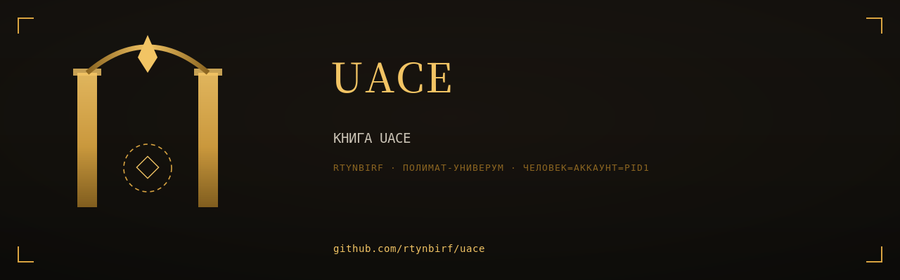

# КНИГА UACE

  

> Собрана 2026-11-11 из 2 репозиториев аккаунта rtynbirf. Каждая глава — снимок `main` оригинала на дату сборки (см. `PROVENANCE.md` внутри главы). Оригиналы архивированы read-only, история коммитов сохранена там.

## Оглавление

| Глава | Источник | Файлов | Коммитов в ориг. | Снимок |
|---|---|---|---|---|
| [uace-pml](glavy/uace-pml/) | [оригинал](https://github.com/rtynbirf/uace-pml) | 318 | 38 | `114bf13` |
| [uace-polymat](glavy/uace-polymat/) | [оригинал](https://github.com/rtynbirf/uace-polymat) | 45 | 17 | `60022dd` |

## О чём эта книга

Книга: UACE x PML одним томом — Universal AI Chat Exporter + userscripts + Cookie Vault MV3. Слито из 2 дублей-репозиториев rtynbirf.

## Как читать

Каждый каталог в `glavy/` — самостоятельная глава со своим README (если оно было в оригинале). Оглавление главы не переименовывалось: имена совпадают с именами исходных репозиториев, чтобы работали старые ссылки в документах.
