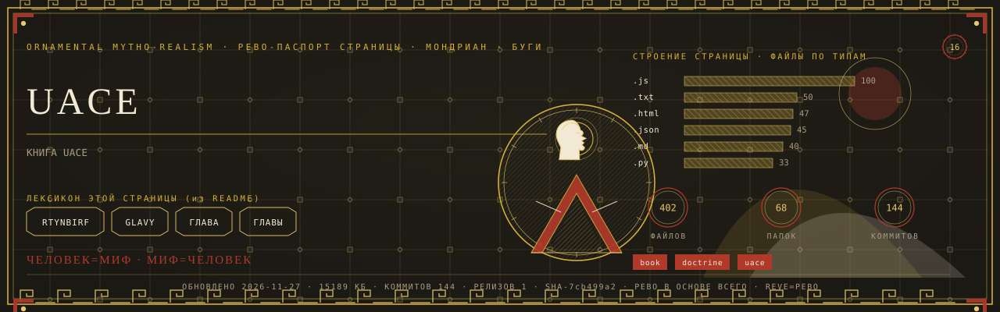

# КНИГА UACE

  

<!--ФОРЖ:МУЗА:НАЧАЛО-->

  
   
  

<!--ФОРЖ:МУЗА:КОНЕЦ-->

<!--ФОРЖ:ПАСПОРТ:НАЧАЛО-->

  

| ФАЙЛОВ | ПАПОК | КОММИТОВ | ОБНОВЛЕНО | РЕЛИЗОВ |
|---:|---:|---:|---|---:|
| 398 | 67 | 118 | 2026-11-21 | 1 |
<!--ФОРЖ:ПАСПОРТ:КОНЕЦ-->

> Собрана 2026-11-11 из 2 репозиториев аккаунта rtynbirf. Каждая глава — снимок `main` оригинала на дату сборки (см. `PROVENANCE.md` внутри главы). Оригиналы архивированы read-only, история коммитов сохранена там.

## Оглавление

| Глава | Источник | Файлов | Коммитов в ориг. | Снимок |
|---|---|---|---|---|
| [uace-pml](https://github.com/rtynbirf/uace/tree/main/glavy/uace-pml) | [оригинал](https://github.com/rtynbirf/uace-pml) | 318 | 38 | `114bf13` |
| [uace-polymat](https://github.com/rtynbirf/uace/tree/main/glavy/uace-polymat) | [оригинал](https://github.com/rtynbirf/uace-polymat) | 45 | 17 | `60022dd` |

## О чём эта книга

Книга: UACE x PML одним томом — Universal AI Chat Exporter + userscripts + Cookie Vault MV3. Слито из 2 дублей-репозиториев rtynbirf.

## Как читать

Каждый каталог в `glavy/` — самостоятельная глава со своим README (если оно было в оригинале). Оглавление главы не переименовывалось: имена совпадают с именами исходных репозиториев, чтобы работали старые ссылки в документах.

## Как читать книгу

- Каждая глава (`glavy/<глава>/`) — снимок `main` оригинала на дату сборки; происхождение и SHA снимка — в `PROVENANCE.md` внутри главы.
- Правки — только в оригиналах (ссылки в оглавлении выше); оригиналы архивированы read-only, история коммитов сохранена в них.
- Ядро дома — [polymath-core](https://github.com/rtynbirf/polymath-core); живой реестр аккаунта — [index](https://github.com/rtynbirf/index).

- Онлайн-версия тома: https://rtynbirf.github.io/uace/
- Лицензия тома — MIT ([LICENSE](LICENSE)); у каждой главы — лицензия её оригинала.

<!--ФОРЖ:ПОДВАЛ-->
---

  ◆ картина и штандарт — ручная ковка <a href="https://github.com/rtynbirf">КУЗНИ ПОЛИМАТ</a> · ЧЕЛОВЕК=АККАУНТ=PID1 ◆

